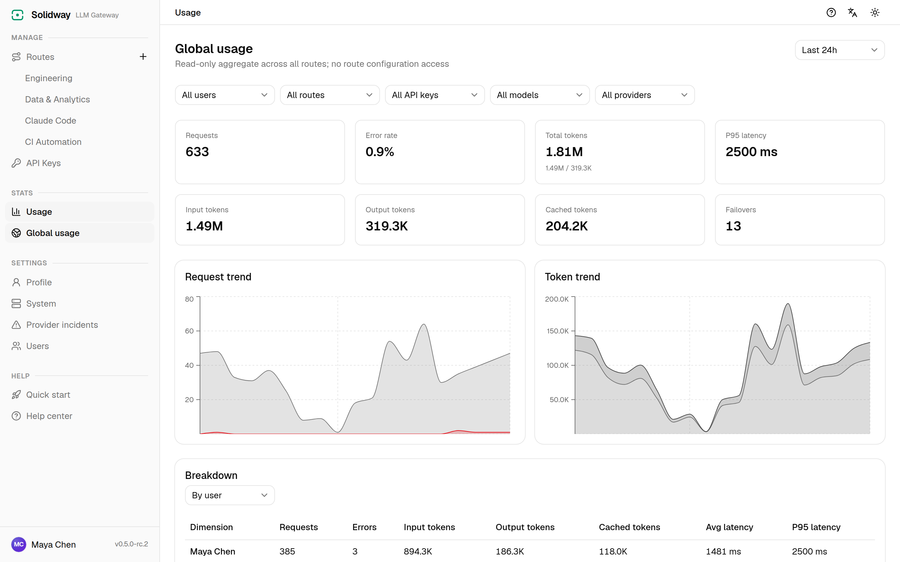
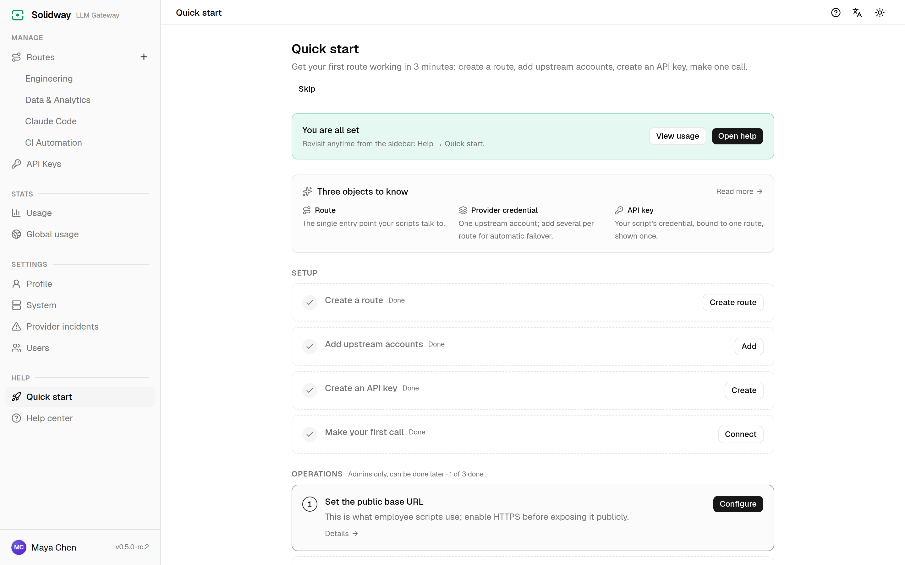
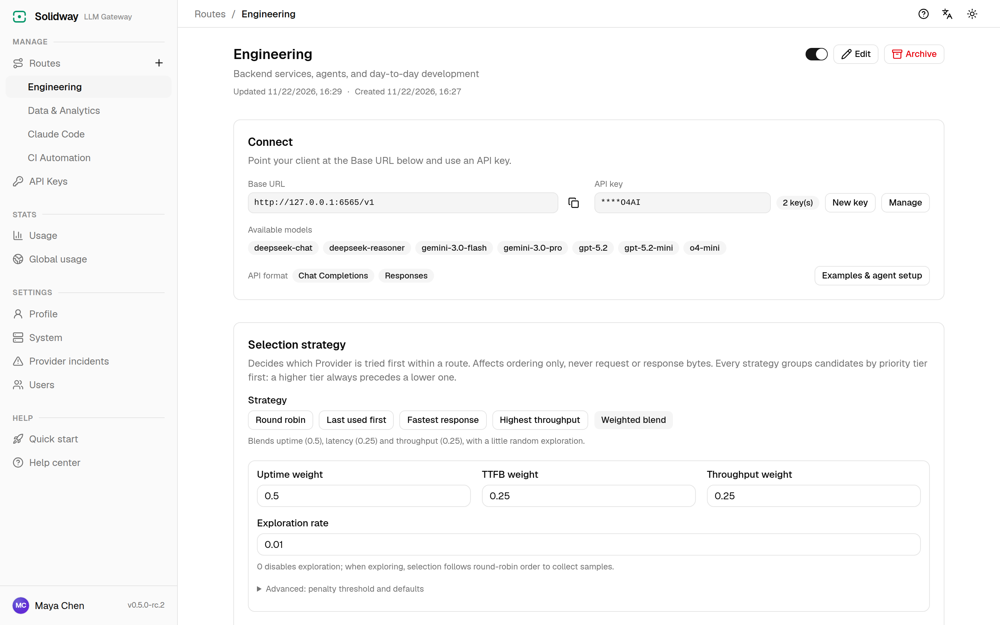
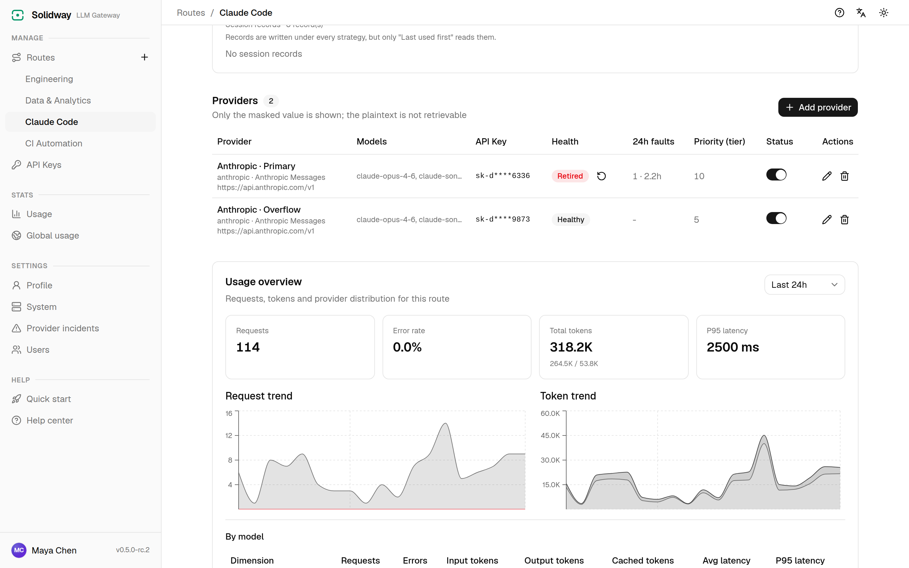
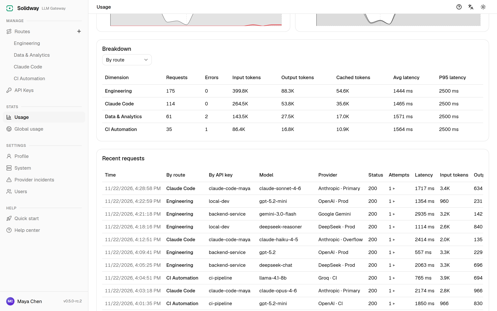
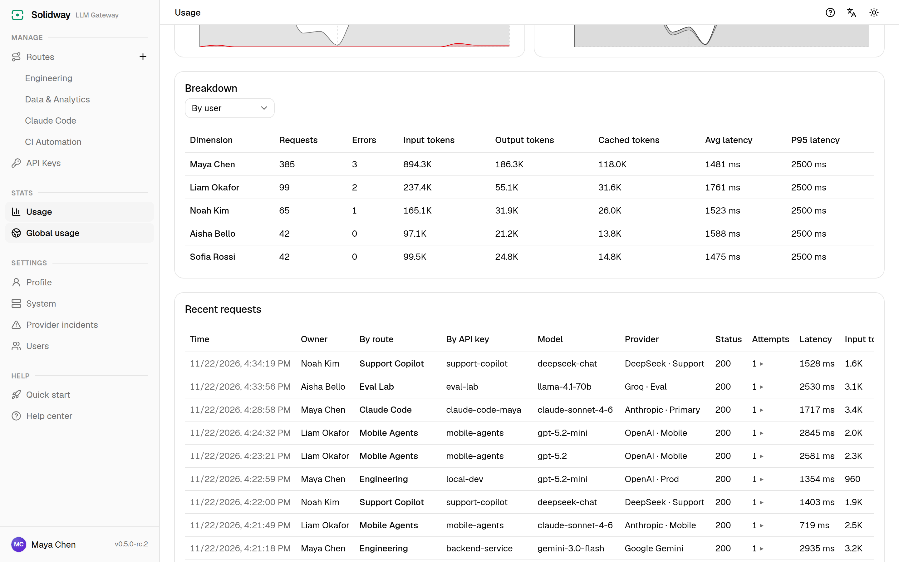
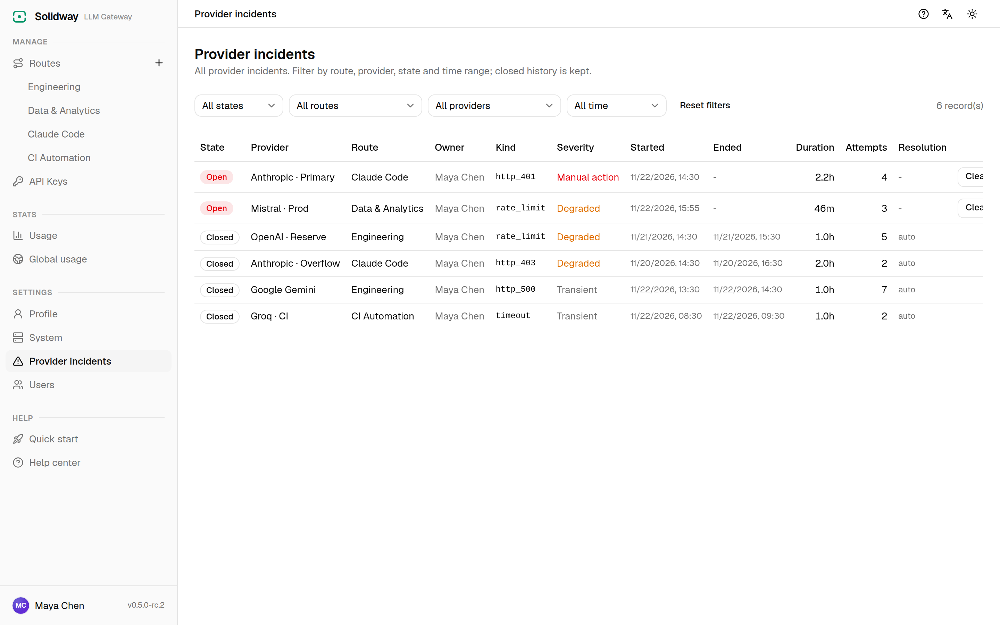

<div align="right">

**English** · [中文](README.zh.md)

</div>

# Solidway

**Your team's LLM accounts, behind one local endpoint.**

Solidway is a desktop app for Linux, Windows and macOS. It runs a local LLM gateway, keeps your
upstream credentials encrypted on this machine, and gives every app — scripts, IDEs, agents and
notebooks — one endpoint with account pooling, failover, API keys and usage attribution.

[](https://github.com/zeaphoo/solidway/actions/workflows/ci.yml)

<p align="center">
  
</p>

## Install and first run

Download the installer for your platform from the
[latest release](https://github.com/zeaphoo/solidway/releases/latest). The desktop app bundles the
gateway — there is nothing else to install.

1. Launch **Solidway**. It starts the gateway on this machine and opens the console.
2. Set the administrator password when prompted.
3. Create a **route** — the single endpoint your clients will call.
4. Add one or more **provider credentials** to the route. Each credential is one upstream account;
   two or more accounts in a route let Solidway fail over automatically.
5. Create an **API key** for the route and copy it immediately. The plaintext is shown once.
6. Point your client at the Base URL shown on the route page and authenticate with that key.

<p align="center">
  
</p>

The Quick start checklist tracks the same steps and stays available from the sidebar. The built-in
Help center covers concepts, client snippets and troubleshooting.

## Connect a client

The default Base URL is `http://127.0.0.1:6565/v1`. Copy the key from the route page and make a
request:

```bash
export SOLIDWAY_KEY="sw-..."

curl http://127.0.0.1:6565/v1/chat/completions \
  -H "Authorization: Bearer $SOLIDWAY_KEY" \
  -H "Content-Type: application/json" \
  -d '{
    "model": "gpt-5.2",
    "messages": [{ "role": "user", "content": "Hello" }]
  }'
```

OpenAI Chat Completions, OpenAI Responses and Anthropic Messages all share the same listener. Use
the Base URL and API key shown on the route page. Anthropic SDKs and Claude Code expect the root
without the trailing `/v1`; the route page's examples fill in the right value for each client.
Existing SDKs that speak one of these protocols work without code changes.

<p align="center">
  
</p>

## Core concepts

| Object | What it means |
|---|---|
| **Route** | A stable entry point backed by a pool of upstream accounts. Clients only know the route. |
| **Provider credential** | One upstream account (API key, service account or AWS credentials). Stored encrypted and shown masked. |
| **API key** | The caller's credential, bound to exactly one route. Revoke or rotate it without touching provider accounts. |
| **Priority tier** | Credentials are tried by tier first. Higher tiers are preferred; lower tiers are the fallback. |

## What you can do

### Pool accounts and fail over

Add several credentials to a route and pick a selection strategy: round robin, last used, fastest
response, highest throughput, or a weighted blend of uptime, latency and throughput. Health is
tracked continuously: a rejected credential is retired until you restore it, rate limits and quota
errors enter a timed cooldown, and request errors never remove an account. If a response has not
started yet, Solidway switches accounts silently — the client never sees the failed attempt.

<p align="center">
  
</p>

### Attribute usage

See requests, errors, tokens, cache hits, latency and failovers by route, API key, model, provider
or owner. Switch between 24 hours, 7 days, 30 days or a custom range, then inspect recent requests
and their individual attempts.

<p align="center">
  
</p>

<p align="center">
  
</p>

### Catch provider trouble early

Provider failures become incidents with duration, attempt counts and severity. Open issues,
cooldowns and retired credentials are visible in one place, and alerts can be delivered to a webhook.

<p align="center">
  
</p>

### Share without sharing credentials

Admins manage users, routes and system settings. Route owners get their own API keys and usage
view without seeing anyone else's routes or upstream credentials. Provider secrets are encrypted at
rest and only ever displayed masked.

## Desktop behavior

Solidway lives in the system tray. Closing the window can keep the gateway running in the
background; the tray menu reopens the console, restarts the gateway, toggles autostart and
close-to-tray, or quits the app. Quitting from the tray stops the gateway.

## Local-first by design

Routes, credentials, users, API keys and usage live in a local SQLite database. The gateway talks to
your provider accounts directly and does not contact a cloud control plane. Back up the app's data
folder together with its master key — without the master key, stored provider credentials cannot be
decrypted.

## Good to know

- **No protocol translation.** A client must speak the dialect its provider expects; Solidway
  forwards request and response bodies unchanged.
- **No prompt or response rewriting.** Only the top-level model alias is rewritten when a credential
  maps a client-facing name to a different upstream id.
- **No resale of model access.** Solidway pools accounts you already own.
- **Webhook alerts only.** No email or Slack integration yet.

## Status

| | |
|---|---|
| Version | `0.5.0-rc.2`, pre-1.0 — interfaces may change between minor releases |
| Platforms | Linux, macOS and Windows desktop |
| License | Apache-2.0 |

Released under the Apache-2.0 license. See [`LICENSE`](LICENSE) and [`NOTICE`](NOTICE).

## Further reading

- [Architecture](docs/architecture.md) — process layout, crates and data model
- [Changelog](CHANGELOG.md) — user-visible changes per release
- [Contributing](CONTRIBUTING.md) — development workflow and required checks
- Built-in **Help center** — concepts, common tasks, client snippets and troubleshooting
