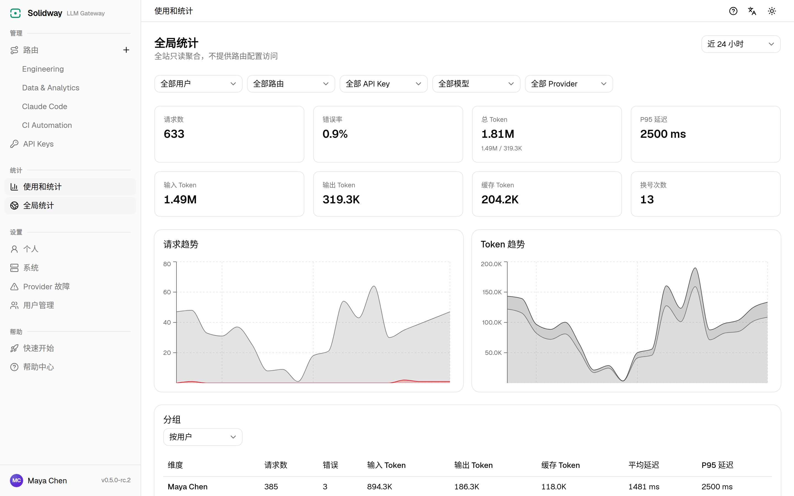
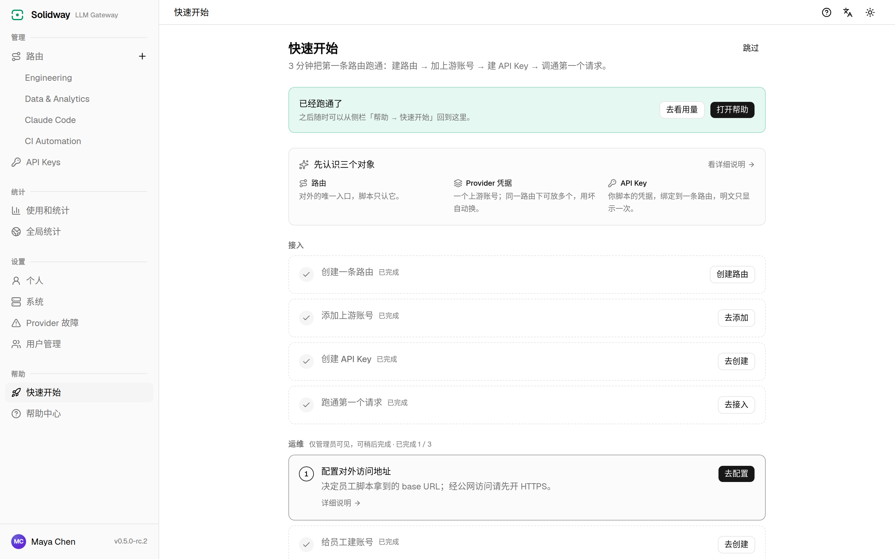
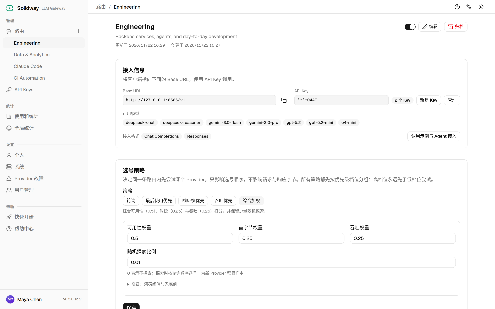
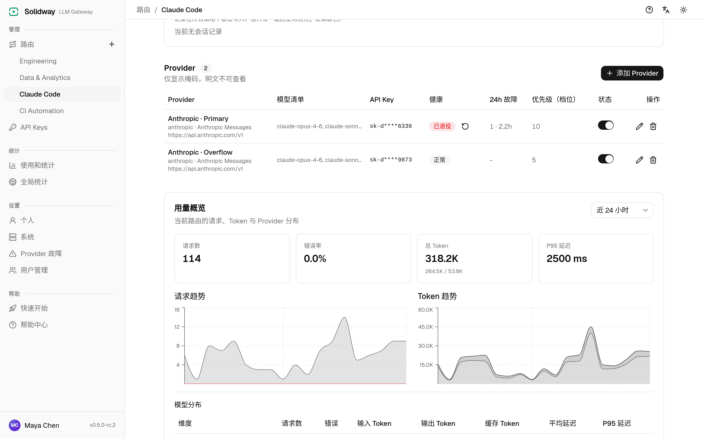
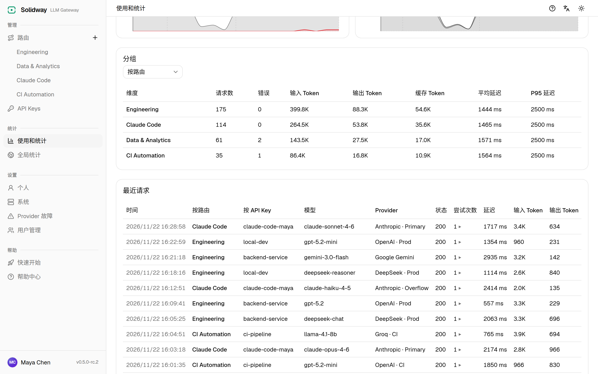
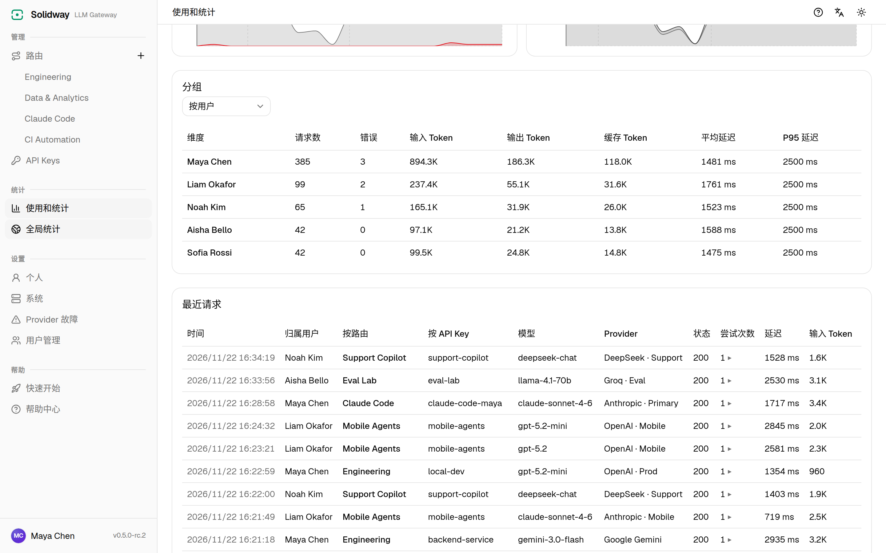
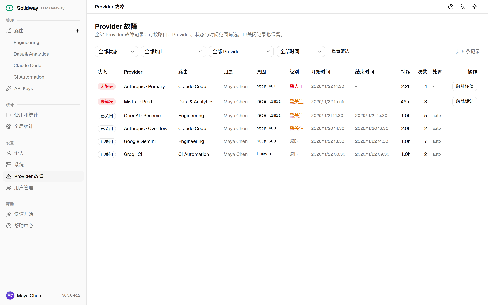

<div align="right">

[English](README.md) · **中文**

</div>

# Solidway

**把团队的 LLM 账号，收在一个本地端点后面。**

Solidway 是一款面向 Linux、Windows 与 macOS 的桌面应用。它在本机运行 LLM 网关，把上游凭据加密
保存在本地，为脚本、IDE、Agent 与 Notebook 提供统一端点：账号池、自动换号、API Key 与用量归因
都收在一个控制台里。

[](https://github.com/zeaphoo/solidway/actions/workflows/ci.yml)

<p align="center">
  
</p>

## 安装与首次使用

从 [最新发布](https://github.com/zeaphoo/solidway/releases/latest) 下载对应平台的安装包。桌面应用
已经内置网关，不需要另外安装服务。

1. 启动 **Solidway**，它会在这台机器上启动网关并打开控制台。
2. 按提示设置管理员口令。
3. 新建一条**路由**——这就是客户端之后调用的唯一入口。
4. 给路由添加一个或多个 **Provider 凭据**。每个凭据代表一个上游账号；同一路由下放两个以上账号
   即可自动换号。
5. 为路由创建 **API Key** 并立即复制。明文只显示这一次。
6. 把客户端的 Base URL 指向路由页显示的地址，用刚创建的 Key 认证。

<p align="center">
  
</p>

「快速开始」会跟踪同样的步骤，也可以随时从侧栏重新打开。应用内还带有帮助中心，涵盖概念说明、
客户端示例与故障排查。

## 连接客户端

默认 Base URL 是 `http://127.0.0.1:6565/v1`。从路由页复制 Key 后直接发请求：

```bash
export SOLIDWAY_KEY="sw-..."

curl http://127.0.0.1:6565/v1/chat/completions \
  -H "Authorization: Bearer $SOLIDWAY_KEY" \
  -H "Content-Type: application/json" \
  -d '{
    "model": "gpt-5.2",
    "messages": [{ "role": "user", "content": "你好" }]
  }'
```

OpenAI Chat Completions、OpenAI Responses 与 Anthropic Messages 共用同一个监听端口。使用路由页
显示的 Base URL 与 API Key 即可；Anthropic SDK 与 Claude Code 需要去掉末尾 `/v1` 的根地址，
路由页的示例会按客户端填好正确的值。只要现有 SDK 使用其中一种协议，就不需要改代码。

<p align="center">
  
</p>

## 核心概念

| 对象 | 说明 |
|---|---|
| **路由** | 对客户端稳定的入口，背后是一池上游账号。客户端只需要知道路由。 |
| **Provider 凭据** | 一个上游账号（API Key、Service Account 或 AWS 凭据）。加密落库，界面只显示掩码。 |
| **API Key** | 调用方凭据，绑定唯一一条路由。吊销或轮换它，不需要动上游账号。 |
| **优先级档位** | 选号先按档位分组：高档位优先，低档位作为兜底。 |

## 可以做什么

### 账号池与自动换号

一条路由可以添加多个 Provider 凭据，并选择选号策略：轮询、最后使用优先、最快响应、最高吞吐，
或按时延 / 吞吐 / 可用性加权的综合策略。健康状态持续更新：凭据失效会退役，等人工恢复；限流与
额度问题进入定时冷却；由请求本身引起的错误不会把账号移出选号。只要响应还没开始回包，Solidway
就会静默切换到下一个账号，客户端看不到这次失败。

<p align="center">
  
</p>

### 用量归因

按路由、API Key、模型、Provider 或归属人查看请求数、错误、Token、缓存命中、延迟与换号次数。
时间范围可以选近 24 小时、7 天、30 天或自定义区间；下方还能逐条查看最近请求及每次尝试。

<p align="center">
  
</p>

<p align="center">
  
</p>

### 及时发现 Provider 故障

Provider 故障会记录为事件，带持续时间、尝试次数与严重级别。未解决事件、冷却中的账号与已退役
凭据都在一处展示；告警可以推送到 Webhook。

<p align="center">
  
</p>

### 共享账号，不共享凭据

管理员管理用户、路由与系统设置；路由拥有者只能看到自己的 API Key 与用量，看不到别人的路由和
上游凭据。Provider 密钥加密保存，界面上始终只显示掩码。

## 桌面行为

Solidway 常驻系统托盘。关闭窗口可以让网关继续在后台运行；托盘菜单可以重新打开控制台、重启
网关、切换开机自启动与关闭到托盘，或退出应用。从托盘退出会停止网关。

## 本地优先

路由、凭据、用户、API Key 与用量都保存在本地 SQLite 数据库里。网关直接连接你的上游账号，不会
访问云端控制面。备份应用数据目录时，请把主密钥一起备份——没有主密钥，已保存的 Provider 凭据
无法解密。

## 需要知道

- **不做协议翻译。** 客户端需要用目标 Provider 认识的方言说话；Solidway 原样转发请求体与响应体。
- **不改写提示词与响应。** 只有当凭据把对外模型名映射到不同上游 id 时，才会改写顶层 `model` 字段。
- **不转售模型访问权限。** 它只负责把你已有的账号池化。
- **目前只有 Webhook 告警。** 还没有邮件或 Slack 集成。

## 状态

| | |
|---|---|
| 版本 | `0.5.0-rc.2`，1.0 之前，minor 版本之间接口可能变化 |
| 平台 | Linux、macOS、Windows 桌面 |
| 许可证 | Apache-2.0 |

以 Apache-2.0 许可发布。详见 [`LICENSE`](LICENSE) 与 [`NOTICE`](NOTICE)。

## 延伸阅读

- [架构说明](docs/architecture.zh.md) —— 进程布局、crate 划分与数据模型
- [变更日志](CHANGELOG.md) —— 每个版本的用户可见变更
- [参与贡献](CONTRIBUTING.zh.md) —— 开发流程与必须通过的检查
- 应用内 **帮助中心** —— 概念、常见任务、客户端示例与故障排查
